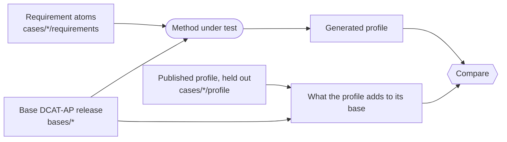

# Profile benchmark references

Reference requirements for five DCAT application profiles, each paired with the profile that was published in answer to them and with the DCAT-AP release that profile extends.

The material is laid out for benchmarks of requirements-driven profile generation (RQ2): requirement atoms go in, the published profile is held out, and what a method produces is compared with what the published profile adds to its base.



This repository is a fork of the RQ1 reference library (`requirements-benchmark-references`) at commit `38ea671` of 12 November 2026. The requirement sets are unchanged, byte for byte. Extraction inputs, benchmark runs and review records were removed; the published profiles and their bases were added. [docs/fork-notes.md](docs/fork-notes.md) lists every change.

## The five cases

| Case | Requirements | Requirement source | Published profile | Profile in machine-readable form | Base |
|---|---|---|---|---|---|
| [jrc-research](cases/jrc-research/README.md) | 11 rows, 18 atoms | Workshop paper of Nov 2016 (cited, not copied) | DCAT-AP-JRC Version 1, 3 Jul 2019 | No: tables in HTML | DCAT-AP 1.1 |
| [statdcat](cases/statdcat/README.md) | 22 rows, 27 atoms | StatDCAT-AP 1.0.0 report | StatDCAT-AP 1.0.0, 15 Dec 2016 | RDF with usage notes, no SHACL | DCAT-AP 1.1 |
| [geodcat](cases/geodcat/README.md) | 46 rows, 56 atoms | GeoDCAT-AP 1.0 specification | GeoDCAT-AP 1.0, 23 Dec 2015 | No: tables in PDF and DOCX | DCAT-AP 1.1 |
| [healthdcat](cases/healthdcat/README.md) | 69 rows, 121 atoms | HealthData@EU Pilot D6.2, 30 Sep 2024 | HealthDCAT-AP pilot draft as of 20 Sep 2024 | No: tables in HTML | DCAT-AP 3.0.0 |
| [mobilitydcat](cases/mobilitydcat/README.md) | 40 rows, 98 atoms | NAPCORE requirement analysis v1.0, 2022 (cited, not copied) | mobilityDCAT-AP 1.0.0, 16 Oct 2023 | RDF and SHACL | DCAT-AP 2.0.1 |
| **All** | 188 rows, 320 atoms | | | | |

The profile releases are the ones that go with the requirement sources RQ1 froze, not the newest ones, and the bases are the ones RQ1's runs pin. Every release and base was checked against what RQ1 records; the result is under [Checked against RQ1](#checked-against-rq1) and the evidence in [docs/versions.md](docs/versions.md).

In RQ1, jrc-research and statdcat were development cases and the other three were test cases (curator's statement of 12 November 2026).

## Do the additions come from the requirements?

All findings of this work are listed in [docs/findings.md](docs/findings.md). Checked per case in [docs/additions-trace.md](docs/additions-trace.md): statdcat and geodcat trace completely, mobilitydcat takes 17 additions from GeoDCAT-AP 2.0.0, healthdcat has 7 untraced additions, and about half of DCAT-AP-JRC Version 1's additions answer requirements the 2016 paper does not state.

## Layout

```text
benchmark.json            index: case -> requirements, profile, base, upstream source and commit
SHA256SUMS                digest of every data file under cases/ and bases/
cases/<case>/
    README.md             what the case holds and what is open
    requirements/         reference-set.json (rows and atoms, as in RQ1) and atoms.csv (flat view)
    profile/              the published profile; upstream files, unchanged
    provenance/           licence evidence, where a file needs it
cases/atoms.csv           the atoms of all cases in one table
cases/counts.json         counts per case
cases/term-check.csv      atom statements that carry a term or name their target profile
cases/rq1-row-coding.csv  earlier coding of 75 rows against profile terms; not gold
bases/<id>/               the DCAT-AP releases the profiles extend; upstream files, unchanged
bases/rq1-registries/     the base registries RQ1's runs pin, and the 2015 PDF of DCAT-AP 1.1 behind one of them
analysis/additions/       per case: each addition of the profile to its base, traced to the atoms
docs/                     data dictionary, version evidence, fork notes, additions trace
tools/                    fetch_upstream.py, build_views.py, validate.py
```

Every file in a `profile/` or `bases/<id>/` folder is a copy of an upstream file under its upstream name. [bases/README.md](bases/README.md) describes the bases.

## Using it

- **Input.** The `statement` of an atom is the requirement in one sentence. No statement carries an IRI or a prefixed name. Two system atoms name their target profile, G-46.1 and Req-39.2 (`cases/term-check.csv`).
- **Held out.** Everything else stays on the evaluator's side: the other fields of an atom (several quote the profile or name its terms), the `profile/` folders, `cases/rq1-row-coding.csv` and the READMEs. A method may see the base of a case; it must not see the target profile.
- **Reference.** A generated profile is compared with the difference between the published profile and its base. That difference is not in this repository yet.
- **Selection.** `stratum`, `status_in_source`, `relation_to_base` and `scored_by_default` let a run choose its atoms. They are RQ1's labels; which atoms RQ2 uses is not decided here.

Field by field: [docs/data-dictionary.md](docs/data-dictionary.md).

## What is here and what is not

- The requirements are complete as RQ1 version 3 has them. Their status is RQ1's: merged sets with a provisional adjudication of the reviewed items, not adjudicated independently as a whole.
- All five profiles and the bases are stored with their upstream commit and digest. For statdcat, geodcat and mobilitydcat the release and the upstream commit are the ones RQ1 had pinned. The three base registries have the digests RQ1's runs record.
- Only mobilityDCAT-AP 1.0.0 has SHACL shapes. StatDCAT-AP 1.0.0 has an RDF description with obligations and cardinalities in usage notes. For the other three profiles the constraints exist only as tables in the specification, so their difference to the base has to be built from those tables.
- Not here: gold differences (deltas), an alignment of atoms to profile elements, counterfactual atoms, and Construct-DCAT, the unseen case, whose requirements are not in the RQ1 library.

## Checked against RQ1

RQ1 is the standard: its reference sets, its row coding and the bases its runs pin. Checked on 13 November 2026:

| Point | Result |
|---|---|
| Bases | RQ1's runs pin `dcat-ap-1.1.0` for jrc-research, statdcat and geodcat, `dcat-ap-2.0.1` for mobilitydcat and `dcat-ap-3.0.0` for healthdcat. The bases here are those releases, and the registries in `bases/rq1-registries/` have the pinned digests. |
| jrc-research, profile | All 5 terms RQ1 coded for the published rows, and all 4 named in atom notes, are in DCAT-AP-JRC Version 1. |
| healthdcat, profile | 31 of the 34 terms RQ1 coded are in the draft of 20 September 2024. The other 3 are in D6.2 but in no state of the draft, so another date would not change the result. |
| mobilitydcat, profile | All 58 coded terms are in mobilityDCAT-AP 1.0.0. |

Two limits remain and cannot be closed from these sources:

1. **jrc-research.** The requirements are from 2016 and Version 1 is from 2019; nothing from 2016 was found. Version 1 names DCAT-AP 1.2.1 as its base, while RQ1 uses 1.1. Compared with 1.1, the profile's difference also contains what DCAT-AP itself gained between 1.1 and 1.2.1.
2. **healthdcat.** The draft has no version numbers. The copy is its last state before the date of D6.2; its tables are the same on 30 October 2024.

## Check and rebuild

```sh
python3 tools/validate.py                 # offline: index, checksums, reference sets, views, RDF, links
sha256sum -c SHA256SUMS                   # the same digests with coreutils
python3 tools/fetch_upstream.py --check   # compare every profile and base file with its upstream commit
python3 tools/build_views.py              # rebuild atoms.csv, counts.json and term-check.csv
```

The tools use the Python standard library. `validate.py` also parses the RDF files when `rdflib` is installed. After a change under `cases/` or `bases/`, run `python3 tools/validate.py --write-checksums`.

## Attribution and reuse

Source documents keep their own notices and reuse conditions; see [THIRD-PARTY-NOTICES.md](THIRD-PARTY-NOTICES.md). No blanket licence overrides those terms.
